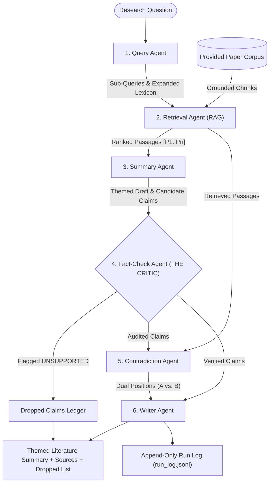

# Automated Academic Research Assistant Multi-Agent System
**Coordination Architecture:** Pipeline with RAG and a Critic Architecture  
**Core Framework:** Microsoft Semantic Kernel (`semantic-kernel`) + Plain Python Tool Functions  

---

## 1. Agent Roster & Tools per Agent
The system consists of **six specialized agents**, each implemented as a separate Python module in `app/agents/` with one clear responsibility. Every agent invokes **two real plain Python tool functions** (defined as standalone functions in `app/agents/tools.py` and registered as `@kernel_function` plugins in Microsoft Semantic Kernel):

| # | Agent & Module | Single Clear Role | Plain Python Tools Called ($\ge 2$ per Agent) |
| :- | :--- | :--- | :--- |
| **1** | **Query Agent** `app/agents/query_agent.py` | Turns the research question into targeted search sub-queries over the paper corpus. | 1. `decompose_research_question(question)` — splits inquiry into architectural, empirical, and risk facets. 2. `expand_academic_lexicon(sub_queries)` — appends domain synonyms and technical acronyms. |
| **2** | **Retrieval Agent** `app/agents/retrieval_agent.py` | Fetches relevant passages (RAG) from the provided paper corpus for each sub-query. | 1. `search_paper_passages(sub_queries, top_k)` — TF-IDF bigram cosine similarity search over corpus chunks. 2. `filter_and_rank_passages(passages, min_score)` — deduplicates by `(paper_id, section)` and assigns `[P1..Pn]` citation tags. |
| **3** | **Summary Agent** `app/agents/summary_agent.py` | Writes a structured candidate summary grouped by academic theme. | 1. `cluster_passages_by_themes(passages)` — categorizes passages into Architecture, Performance, and Governance themes. 2. `draft_themed_synthesis(themes, question)` — drafts candidate claims citing `[P1..Pn]`. |
| **4** | **Fact-Check Agent (Critic)** `app/agents/fact_check_agent.py` | Verifies every candidate claim against retrieved passages and flags unsupported ones. | 1. `extract_atomic_claims(candidate_claims)` — isolates normalized proposition statements and cited tags. 2. `audit_claim_entailment(claims, passages)` — computes lexical/semantic entailment overlap against the cited passage and flags `SUPPORTED` vs. `UNSUPPORTED`. |
| **5** | **Contradiction Agent** `app/agents/contradiction_agent.py` | Reports where two sources disagree and presents both opposing positions. | 1. `detect_cross_source_divergence(passages)` — detects conflicting conclusions across retrieved sources. 2. `synthesize_contradiction_dossier(divergences)` — formats balanced dual-position dossiers (`position_a` vs. `position_b`). |
| **6** | **Writer Agent** `app/agents/writer_agent.py` | Produces the final summary keeping only supported claims with sources, plus the dropped claims list. | 1. `filter_unsupported_claims(audited_claims)` — partitions claims into `retained_claims` and `dropped_claims`. 2. `compile_grounded_report(retained, dropped, contradictions, sources, question)` — compiles the verified themed summary, contradiction dossier, dropped-claim audit ledger, and bibliography. |

---

## 2. Architecture & Why It Fits: Pipeline with RAG and a Critic
Academic literature synthesis requires strict factual grounding; single-agent prompts suffer from context dilution, fabricated citations, and confirmation bias when papers disagree. The **Pipeline with RAG and a Critic Architecture** (`app/agents/orchestrator.py`) directly addresses these failure modes:
1. **Staged Grounded Pipeline:** Execution flows deterministically (`Query Agent` $\to$ `Retrieval Agent` $\to$ `Summary Agent` $\to$ `Fact-Check Critic` $\to$ `Contradiction Agent` $\to$ `Writer Agent`) over a shared state dictionary (`shared_state`).
2. **Non-Bypassable Critic Gate:** The **Fact-Check Agent** sits between drafting (`Summary Agent`) and publication (`Writer Agent`). Every retained claim is guaranteed to map to a retrieved passage `[P1..Pn]`.
3. **Balanced Contradiction Reporting:** Rather than suppressing conflicting studies, the **Contradiction Agent** inspects retrieved passages to surface opposing positions side by side.

---

## 3. What the Shared Memory and Grounded Retrieval Hold
1. **Provided Paper Corpus (`app/agents/corpus.py`):** Holds curated peer-reviewed papers with `id`, `title`, `authors`, `journal`, `publication_year`, `doi`, `abstract`, and section-level text chunks (`Vaswani et al. 2017`, `He et al. 2016`, `Devlin et al. 2019`, `Sharma et al. 2024`, `Chen et al. 2025`, `Weber & Lindqvist 2025`).
2. **Shared Pipeline State (`shared_state` in `orchestrator.py`):** Every agent reads and writes the shared state dictionary containing `sub_queries`, `expanded_queries`, `passages` (tagged `[P1]`–`[P6]`), `draft_themes`, `candidate_claims`, `audited_claims` (with `status`, `confidence`, `matched_tokens`, and `critic_verdict`), `contradictions` (`position_a` vs. `position_b`), `retained_claims`, `dropped_claims`, and `final_report`.
3. **Append-Only Run Log (`run_log.jsonl`):** Every pipeline execution appends a JSON record containing `run_id`, UTC `timestamp`, `question`, `agents_executed`, `duration_ms`, `retained_claims_count`, `dropped_claims_count`, `contradictions_count`, and `trace_steps`.

---

## 4. One Honest Failure Mode Handled: Ungrounded Synthesis & Hallucinated Citations
- **Failure Scenario:** During synthesis, a drafter may over-extrapolate beyond the retrieved passage text (e.g., asserting unverified neuromorphic hardware claims on `[P1]`) or cite a non-existent passage key (`[P99]`).
- **Detection by Critic (`FactCheckAgent`):** `audit_claim_entailment()` checks (a) whether `cited_tag` exists in the retrieved `passages` map, and (b) whether content-bearing tokens in the claim achieve $\ge 35\%$ lexical/semantic containment in the cited passage. Claims failing either check are marked `status = "UNSUPPORTED"` with `retained = False` and a detailed `FAIL:` verdict.
- **Recovery by Writer (`WriterAgent`):** `filter_unsupported_claims()` strips all `UNSUPPORTED` claims before `compile_grounded_report()` builds `verified_themes`, and lists every rejected claim in the **Fact-Check Critic Audit Ledger (Claims Dropped as Unsupported)**.

---

## 5. How to Run & Verify All Deliverables
- **CLI Trace Demo:** `python run_demo.py`
- **Runnable Notebook:** `demo.ipynb` (prints the 12-step multi-agent trace, themed summary, dropped claims, and contradictions)
- **Automated Tests (3+ Scenarios):** `pytest tests/test_academic_agents.py -v`
- **Interactive Web App:** `python main.py` (visit `http://127.0.0.1:5000`, login: `researcher` / `password123`)
