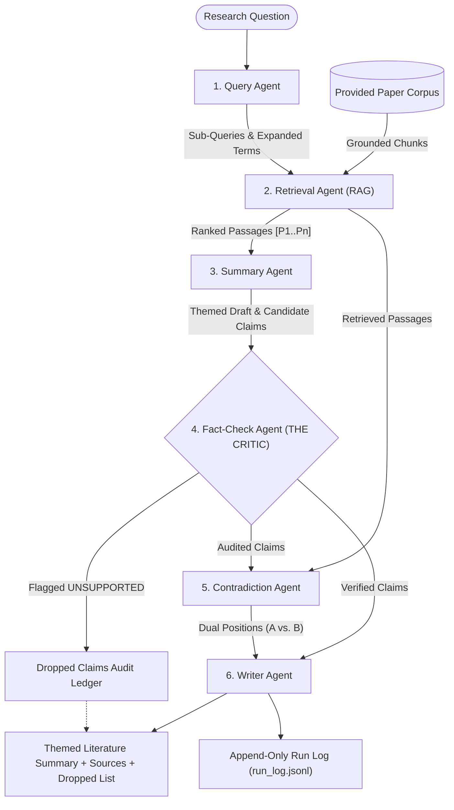

# Automated Academic Research Assistant Multi-Agent System
**Coordination Architecture:** Pipeline with RAG and a Critic Architecture  
**Framework:** Microsoft Semantic Kernel (`semantic-kernel`) + Plain Python Tool Functions  

---

## 1. Agent Roster & Plain Python Tools per Agent
This system is built from **six separate agent modules** (`app/agents/`), each with one clear role and **two plain Python tool functions** (`app/agents/tools.py`) registered as Semantic Kernel `@kernel_function` plugins:

| Agent Module | Clear Role | Plain Python Tools ($\ge 2$ per Agent) |
| :--- | :--- | :--- |
| **1. Query Agent**<br>`app/agents/query_agent.py` | Turns a research question into search sub-queries over the provided paper set. | `decompose_research_question(question)`<br>`expand_academic_lexicon(sub_queries)` |
| **2. Retrieval Agent**<br>`app/agents/retrieval_agent.py` | Fetches relevant passages (RAG) from the provided paper corpus for each sub-query. | `search_paper_passages(sub_queries, top_k)`<br>`filter_and_rank_passages(passages, min_score)` |
| **3. Summary Agent**<br>`app/agents/summary_agent.py` | Writes a structured candidate summary grouped by theme. | `cluster_passages_by_themes(passages)`<br>`draft_themed_synthesis(themes, question)` |
| **4. Fact-Check Agent (Critic)**<br>`app/agents/fact_check_agent.py` | Verifies each claim in the summary against retrieved passages and flags unsupported ones. | `extract_atomic_claims(candidate_claims)`<br>`audit_claim_entailment(claims, passages)` |
| **5. Contradiction Agent**<br>`app/agents/contradiction_agent.py` | Reports where two sources disagree and presents both positions. | `detect_cross_source_divergence(passages)`<br>`synthesize_contradiction_dossier(divergences)` |
| **6. Writer Agent**<br>`app/agents/writer_agent.py` | Produces the final summary keeping only supported claims with sources and dropped-claim list. | `filter_unsupported_claims(audited_claims)`<br>`compile_grounded_report(retained, dropped, ...)` |

---

## 2. Coordination Architecture & Why It Fits
Single-prompt summarization frequently blends conflicting papers and hallucinates citations. A **Pipeline with RAG and a Critic Architecture** (`app/agents/orchestrator.py`) solves this by:
- **Grounding Every Step in Corpus RAG:** `RetrievalAgent` tags retrieved paper sections with deterministic citation keys (`[P1]`–`[P6]`).
- **Enforcing a Mandatory Critic Gate:** `FactCheckAgent` audits every candidate claim drafted by `SummaryAgent` against the retrieved passages before `WriterAgent` generates the final report.
- **Preserving Competing Academic Positions:** `ContradictionAgent` explicitly isolates cross-source disagreements (`Position A` vs. `Position B`) instead of smoothing them over.

### Architecture Diagram
See also [`architecture_diagram.svg`](architecture_diagram.svg) and [`architecture_diagram.md`](architecture_diagram.md).



---

## 3. What the Retrieval & Shared Memory Hold
- **Grounded Corpus (`app/agents/corpus.py`):** 6 peer-reviewed papers with 19 searchable abstract/section passages (`paper_id`, `paper_title`, `authors`, `year`, `doi`, `section`, `text`).
- **Shared Pipeline State (`shared_state`):** Read and written across all 6 agents, storing `sub_queries`, `expanded_queries`, `passages` (`[P1..Pn]`), `draft_themes`, `candidate_claims`, `audited_claims`, `contradictions`, `retained_claims`, `dropped_claims`, and `final_report`.
- **Append-Only Run Log (`run_log.jsonl`):** Persists an immutable JSONL record for every pipeline execution.

---

## 4. One Honest Failure Handled: Hallucinated & Extrapolated Claims
- **Failure Mode:** `SummaryAgent` drafts an unverified extrapolation beyond the source passage text (or an ungrounded claim citing `[P99]` is injected).
- **Handling:** `FactCheckAgent.audit_claim_entailment()` verifies citation existence and computes token entailment overlap against the cited passage. Claims below the $35\%$ entailment threshold or with missing citations are flagged `UNSUPPORTED`. `WriterAgent.filter_unsupported_claims()` removes them from the final themed summary and records them in the **Dropped Claims Audit Ledger** with the exact rejection reason.

---

## 5. Quick Start & Verification
1. **Run Terminal Demo (prints full multi-agent trace & report):**
   ```bash
   python run_demo.py
   ```
2. **Run Automated Test Suite (3+ scenarios):**
   ```bash
   pytest tests/test_academic_agents.py -v
   ```
3. **Open Runnable Demo Notebook:**
   Open `demo.ipynb` in Jupyter or VS Code.
4. **Launch Interactive Web Dashboard (Optional):**
   ```bash
   python main.py
   ```
   Open `http://127.0.0.1:5000` (Default login: `researcher` / `password123`).
